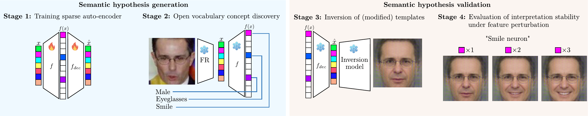

# SCOUT

**SCOUT — Semantic Concept Discovery for Open-Vocabulary Editing of Face Recognition Templates** (IJCB 2026).

Face recognition templates encode rich semantic information beyond identity. SCOUT discovers and validates that semantic structure end-to-end:

1. Train a sparse autoencoder (SAE) on frozen FR templates.
2. Generate semantic hypotheses for SAE neurons from natural-language CLIP queries.
3. Inspect the hypotheses by inverting templates back to images (Deep Face Decoder, optionally Arc2Face).
4. Validate them through neuron-level interventions in template space.



## Setup

```bash
conda env create -f environment.yml
conda activate scout
pip install --force-reinstall torch==2.6.0 torchvision==0.21.0 \
  --index-url https://download.pytorch.org/whl/cu124
```

Default data paths live in `paths.yaml`. Edit that file if your local datasets or downloaded artifacts live elsewhere. It supplies default values for `--glint360k-root`, `--lfw-root`, `--ids-and-fns`, `--clip-templates`, and `--fr-templates`; explicit CLI flags always win.

## Pretrained assets

Use the downloader script to fetch Dropbox-hosted artifacts with `wget` and place them in the directories expected by the code:

```bash
bash download_assets.sh templates      # extracted Glint360K FR + CLIP templates
bash download_assets.sh sae            # pretrained BatchTopK SAE weights
bash download_assets.sh dfd            # pretrained Deep Face Decoder weights
bash download_assets.sh arc2face       # Arc2Face + Stable Diffusion archive
bash download_assets.sh all            # everything above
```

The script groups assets by use case, creates target directories, skips files that already exist, and keeps the Dropbox file URLs out of the README. Downloads are written to `*.part` first and moved into place after `wget` finishes, so interrupted downloads can be resumed safely. The Arc2Face group downloads one zip archive (`downloads/scout_arc2face_assets.zip`) and extracts it automatically. Run `bash download_assets.sh list` to see the exact local targets.

Approximate download sizes:

| Command | Contents | Size |
| --- | --- | ---: |
| `bash download_assets.sh templates` | Glint360K ids, four FR template sets, OpenCLIP templates | ~169 GB |
| `bash download_assets.sh sae` | Four pretrained BatchTopK SAE checkpoints | ~134 MB |
| `bash download_assets.sh dfd` | Four pretrained Deep Face Decoder checkpoints | ~891 MB |
| `bash download_assets.sh arc2face` | Arc2Face, Stable Diffusion, and ArcFace recognizer archive | ~5.1 GB download, ~5.5 GB extracted |
| `bash download_assets.sh all` | Everything above | ~175 GB downloaded, ~180 GB on disk |

## Reproduction

### Extract FR + CLIP templates

```bash
python feature_extractors/extract_templates.py --model adaface_ms1mv2_ires50
```

(Or run `bash download_assets.sh templates` and skip this step.)

### Train an SAE

```bash
python batchtopk/train.py --encoder-id adaface_ms1mv2_ires50
```

(Or run `bash download_assets.sh sae` and skip this step.)

### Train a DFD decoder

```bash
python deep_face_decoder/train.py \
  --config deep_face_decoder/configs/adaface_ms1mv2_ires50.yaml
```

(Or run `bash download_assets.sh dfd` and skip this step.)

### Concept Discovery + Intervention With DFD

```bash
python sae_analysis/clip_attribute_analysis.py \
  --backend dfd \
  --encoder-id adaface_ms1mv2_ires50 \
  --weights batchtopk/runs/adaface_ms1mv2_ires50_k32/weights.pt \
  --decoder-chkpt deep_face_decoder/runs/adaface_ms1mv2_ires50_k32/checkpoints/best.pt \
  --queries sae_analysis/queries/bald.json \
  --run-manipulation-scoring \
  --device cuda:0
```

`--fr-templates`, `--clip-templates`, `--ids-and-fns`, `--lfw-root`, and `--glint360k-root` are all derived from `paths.yaml` when omitted.

### Concept Discovery + Intervention With Arc2Face

```bash
python sae_analysis/clip_attribute_analysis.py \
  --backend arc2face \
  --encoder-id arcface_webface42m_res100 \
  --weights batchtopk/runs/arcface_webface42m_res100_k32/weights.pt \
  --queries sae_analysis/queries/bald.json \
  --run-manipulation-scoring \
  --device cuda:0
```

The Arc2Face backend requires `--encoder-id arcface_webface42m_res100` (the encoder Arc2Face's `project_face_embs` was trained against). Arc2Face and Stable Diffusion weights are loaded from `arc2face/pretrained/` by default.

## Citing

TODO

## Acknowledgments

`arc2face/` vendors the Arc2Face Python package under its original MIT license (Foivos Paraperas Papantoniou). SCOUT also depends on upstream AdaFace, InsightFace ArcFace, SwinFace, and OpenCLIP.
